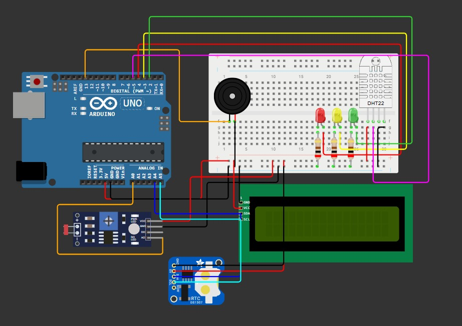

# 🍷 Vinheria Agnello: Monitoramento de Ambiente

**Checkpoint 02 · Edge Computing & Computer Systems · Engenharia de Software · FIAP 2026**

## 👥 Integrantes

| Nome | RM |
|------|----|
| Felipe de Oliveira Corrêa | 574803 |
| Manoel Simião Cavalcante Neto | 575499 |
| Samuel Dantas Silva | 576922 |
| Eduardo Coutinho de Lima | 575349 |
| Eric Sia Mapurunga de Aguiar | 576304 |

## 🔗 Links

- **Simulação no Wokwi:** _(https://wokwi.com/projects/479143435144111105)_
- **Vídeo explicativo:** _(adicionar link)_

## 📌 Sobre o projeto

Na primeira fase, criamos para a Vinheria Agnello um sistema que monitorava a **luminosidade** do local onde os vinhos ficam armazenados. Nesta segunda fase, atendendo aos pedidos dos proprietários, o sistema passou a:

- Medir **temperatura e umidade** com o sensor **DHT22**, que tem o mesmo uso do DHT11 pedido no enunciado (o Wokwi só oferece o DHT22);
- Exibir **temperatura, umidade e luminosidade** em um **display LCD 16x2 com módulo I2C**, que usa apenas 2 fios de dados;
- Sinalizar com **LEDs e buzzer** os níveis de alerta e os níveis críticos das **três grandezas**;
- Usar um **RTC (DS1307)** para registrar data e hora;
- Guardar na **EEPROM** as **configurações** (fuso UTC e unidade de temperatura) e os **logs** das anomalias;
- Calibrar o **LDR** com a função `map()`;
- Trabalhar sempre com a **média dos últimos 10 segundos** de cada grandeza;
- Exibir o **logo da empresa com animação** ao ligar.

## 🧰 Componentes

| Componente | Qtd. | Função |
|-----------|:---:|--------|
| Arduino Uno R3 | 1 | Microcontrolador |
| Sensor DHT22 | 1 | Temperatura e umidade |
| Módulo sensor de luz (LDR) | 1 | Luminosidade (saída analógica AO) |
| Display LCD 16x2 I2C | 1 | Exibição dos valores e do logo |
| RTC DS1307 | 1 | Relógio de tempo real (data e hora) |
| LEDs verde, amarelo e vermelho | 3 | Indicação do estado |
| Resistores de 200 Ω | 3 | Limitam a corrente dos LEDs |
| Buzzer | 1 | Alarme sonoro |
| Protoboard (meia) | 1 | Montagem do circuito e distribuição de 5V/GND |
| Jumpers | – | Ligações |

## 🔌 Ligações

| Componente | Pino do Arduino |
|-----------|-----------------|
| LDR (AO) | A0 |
| DHT22 (dados) | D5 |
| LED vermelho | D4 |
| LED amarelo | D3 |
| LED verde | D2 |
| Buzzer | D13 |
| LCD I2C e RTC: SDA | A4 |
| LCD I2C e RTC: SCL | A5 |

- O **5V e o GND** do Arduino vão para os **barramentos laterais do protoboard** (+ e −), e de lá alimentam o DHT22, o LDR, o LCD, o RTC, os LEDs e o buzzer.
- Cada LED tem o **ânodo** ligado ao pino do Arduino e o **cátodo** ligado ao GND por um **resistor de 200 Ω**, que limita a corrente.
- O LCD (endereço `0x27`) e o RTC (endereço `0x68`) dividem o mesmo **barramento I2C**: cada um tem seu endereço, então os dois usam os mesmos fios SDA e SCL. Com o módulo I2C, o LCD passou de 12 fios (no CP1) para só 4, e não precisa mais do resistor da luz de fundo.

## ⚙️ Funcionamento

### Níveis de cada grandeza

| Grandeza | 🟢 OK | 🟡 Alerta | 🔴 Crítico |
|---------|------|----------|-----------|
| Luminosidade | até 30% | 31% a 60% | acima de 60% |
| Temperatura | 10 °C a 16 °C | 7 °C a 19 °C | abaixo de 7 °C ou acima de 19 °C |
| Umidade | 60% a 80% | 50% a 60% ou 80% a 90% | abaixo de 50% ou acima de 90% |

Os limites seguem o material do caso: penumbra para os vinhos, temperatura ideal de ~**13 °C** (variação máxima de 3 °C) e umidade ideal de ~**70%** (entre 60% e 80%).

- O LED aceso mostra o **pior estado** entre as três grandezas.
- Em **alerta ou crítico**, o buzzer toca por **3 s** e repete a cada **10 s** enquanto a situação continuar.

### Média de 10 segundos
A cada 1 segundo o sistema coleta uma amostra de cada sensor e guarda as **10 últimas** em um buffer circular. Os valores exibidos e avaliados são a **média dessas 10 amostras**, ou seja, dos últimos 10 s. Isso evita alarmes falsos causados por variações momentâneas (por exemplo, alguém acendendo uma luz por um segundo).

### Calibração do LDR com `map()`
No módulo LDR, mais luz gera uma tensão **menor** na saída AO. Medimos pelo Monitor Serial a leitura no escuro (~1015) e no claro máximo (~10) e usamos `map(leitura, 1015, 10, 0, 100)` para converter para 0–100%, com `constrain()` para não sair dessa faixa.

### Telas do LCD
Ao ligar, o LCD mostra a **animação do logo**: duas taças se enchem de vinho, o nome "VINHERIA AGNELLO" aparece letra por letra, a mensagem "Bem-vindo!" surge e o nome pisca. Depois, as telas se alternam a cada 3 s:

1. Data, hora (do RTC) e status geral;
2. Temperatura: `Temperatura OK`, `Temp. BAIXA` ou `Temp. ALTA` + valor;
3. Umidade: `Umidade OK`, `Umidade BAIXA` ou `Umidade ALTA` + valor;
4. Luminosidade: `Ambiente escuro`, `Ambiente a meia luz` ou `Ambiente muito CLARO` + valor.

### RTC e EEPROM
- O **RTC** guarda a hora em **UTC**. O sistema soma o **fuso configurado** (padrão: UTC-3, horário de Brasília).
- A **EEPROM** guarda as **configurações** (fuso e unidade °C/°F), que continuam salvas mesmo depois de desligar o Arduino.
- Enquanto alguma grandeza estiver fora do ideal, o sistema grava um **log** a cada 10 s com data/hora, temperatura, umidade, luminosidade e estado. Os logs ficam em uma **fila circular** de 112 registros: quando enche, o mais antigo é sobrescrito.

### Comandos pelo Monitor Serial (9600 baud)

| Comando | O que faz |
|---------|-----------|
| `AJUDA` | Lista os comandos |
| `UTC=-3` | Define o fuso horário (de -12 a 14) e salva na EEPROM |
| `UNIDADE=C` / `UNIDADE=F` | Temperatura em Celsius ou Fahrenheit (salvo na EEPROM) |
| `LOGS` | Mostra todos os registros gravados na EEPROM |
| `LIMPAR` | Apaga os registros |

## 📦 Dependências

- **Wokwi** (simulação online) ou **Arduino IDE** (placa física);
- Bibliotecas: **LiquidCrystal I2C**, **DHT sensor library** (e sua dependência **Adafruit Unified Sensor**) e **RTClib**. `Wire` e `EEPROM` já vêm com o Arduino.

## ▶️ Como reproduzir

### No Wokwi
1. Abra o link da simulação e clique em **▶ (Start the simulation)**.
2. Assista à animação do logo no LCD.
3. Clique no **LDR**, no **DHT22** e ajuste os controles de luz, temperatura e umidade. Como o sistema usa a média de 10 s, o LED e o LCD mudam alguns segundos depois do ajuste.
4. No **Monitor Serial**, acompanhe os valores e teste os comandos (`LOGS`, `UNIDADE=F`, `UTC=-3`...).

### Em um Arduino físico
1. Monte o circuito conforme a tabela de ligações (com DHT11 ou DHT22: para o DHT11, troque `DHT22` por `DHT11` no código).
2. Instale as bibliotecas pela Arduino IDE (*Ferramentas > Gerenciar Bibliotecas*).
3. Abra o `sketch.ino`, selecione **Arduino Uno** e clique em **Carregar**.
4. Se necessário, recalibre o LDR: veja o "LDR bruto" no Monitor Serial no escuro e no claro e ajuste `LDR_ESCURO` e `LDR_CLARO`.

## 🖼️ Circuito

